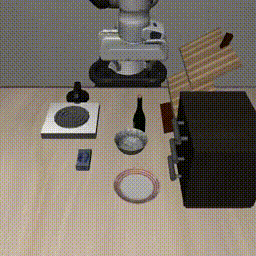

# Robust VLA Manipulation: Synthetic Data & Failure Analysis in Isaac Lab

One AgileX PiPER tabletop setup, one small VLA, measured honestly: where it works, where it breaks, and what data fixes it.

**Aim:** a physical-AI robot-learning portfolio project (Indian robotics companies, humanoid and manipulation startups, remote roles). The value is a reproducible pipeline, a trustworthy eval harness, and clear results, not a novel model.

## Status

| Phase | What | State | Result |
|---|---|---|---|
| 0 | Pinned install, SmolVLA LIBERO number, Arena smoke test, Franka Mimic dry run | done | LIBERO 258/400 (64.5%, 95% CI 59.7–69.0); Mimic yield 35–46% |
| 1 | PiPER twin + end-to-end pipeline on cube stacking | not started | – |
| 2 | Data scaling study | not started | – |
| 3 | Failure analysis + targeted fix | not started | – |
| 4 | Menu, chosen after Phase 3 (see below) | not started | – |
| B | Cyberwave Builders track: "Breakpoint" on the real PiPER ([proposal](PROPOSAL.md)) | applied 2026-10-18 | – |

Every phase ends by filling in its row with a number and a GIF, so the repo is presentable at any point.

## Constraints

- **Compute:** RTX A4000 16GB. Phases 0–3 must fit on it. Larger VLAs (π0.5, GR00T N1.7) do not fine-tune in 16GB; Phase 4 rents a 24–32GB card for that and runs inference locally.
- **Embodiment:** AgileX PiPER (6-DOF, parallel gripper), the arm Cyberwave Builders ships and the builder keeps, in sim from Phase 1 and real in Track B. Demos do not transfer across robots, so sim and real use the same arm. The UFACTORY xArm 7 is a later second embodiment. The real setup has one fixed camera; Phases 1–3 train on the fixed camera only and a wrist camera is a later ablation.
- **Teleop:** keyboard (a PS controller needs one `Se3GamepadCfg` entry in the env config). Mimic needs few human demos; record 15–20, because yield on an untuned PiPER port will be below the stock Franka figure.
- **Time:** first visible result in a few weeks; whole project a couple of months.

## Stack

- **Sim / eval:** Isaac Lab + Isaac Lab-Arena; LIBERO (MuJoCo, via `lerobot-eval`) for the Phase 0 reference number
- **Data:** Isaac Lab Mimic → LeRobot dataset format. Recording task ids use the `IsaacContrib-` prefix (`IsaacContrib-Stack-Cube-Franka-IK-Rel`); only the Mimic variants are named `Isaac-…-Mimic-v0`.
- **Policy:** SmolVLA (450M). If memory is short, train only the action expert and state projection.
- **Baseline:** ACT, on the same data

### Environment

Two conda envs, because LeRobot needs `numpy<2.3` and Isaac Sim 6.1 hard-pins `numpy==2.3.1`.

| Env | Contents | Install |
|---|---|---|
| `env_arena` | Isaac Sim 6.1.0, Isaac Lab 3.0.0 (`91a0906`), Arena `release/0.3.1`, Python 3.12, torch 2.11.0+cu128 | `uv sync --locked --extra dev` in `~/IsaacLab-Arena`, with `UV_PROJECT_ENVIRONMENT` set to the conda env |
| `env_lerobot` | LeRobot 0.6.1, Python 3.12, torch 2.11.0 | `uv pip install "lerobot[smolvla,dataset,evaluation,libero]==0.6.1"` |

The LeRobot EnvHub guide still pins Isaac Sim 5.1 / Isaac Lab 2.3 / Arena 0.1.1, which Isaac Lab 3 no longer supports, so eval runs from the sim side with the policy served from `env_lerobot`. Arena 0.3.1 ships no LeRobot client and no Franka SmolVLA checkpoint exists for it: the policy server (speaking Arena's `openpi_client` websocket protocol) is glue written in Phase 1. Isaac Sim does not run on GPUs without RT cores (A100, H100); those are for training only.

Rule: use the scripts these projects ship. New code is only the glue they lack (HDF5 → LeRobot conversion, policy server, eval sweeps, plots).

## Phases

### Phase 0: Setup (days)

- Pin Isaac Sim, Isaac Lab, Arena and LeRobot versions that work together; record them in this README (see [Environment](#environment)). Done.
- Reproduce a SmolVLA number on LIBERO with `lerobot-eval` and the public `HuggingFaceVLA/smolvla_libero` checkpoint. No training, no new code.
- Run Arena's zero-action smoke test, so the Isaac Sim side is proven.
- Run the stock Franka Mimic pipeline once on the shipped 10 demos and measure yield, wall time and peak VRAM at 8 / 16 / 32 envs with cameras.

**Done when:** `bash scripts/phase0.sh` reproduces the LIBERO number from a clean checkout, and the Mimic yield / VRAM table is in this README.

#### Phase 0 results (2026-10-11, RTX A4000)

**SmolVLA on LIBERO** (`bash scripts/phase0.sh`, checkpoint `HuggingFaceVLA/smolvla_libero`, 10 episodes × 10 tasks per suite, 2 h 52 min):

| Suite | This run | SmolVLA paper (0.45B) |
|---|---|---|
| Spatial | 70/100 | 90 |
| Object | 77/100 | 96 |
| Goal | 73/100 | 92 |
| Long (`libero_10`) | 38/100 | 71 |
| All | 258/400 (64.5%, Wilson 95% CI 59.7–69.0) | 87.3 |

The run is 23 points below the paper. The cause is not established. This is a community checkpoint with no published score of its own (one Hub discussion reports 79/100 on Spatial). Its config replans every step (`n_action_steps=1`); rerunning Spatial with `n_action_steps=10` gave 60/100, so chunk length does not explain the gap. `lerobot/smolvla_libero` expects three differently named cameras and fails `lerobot-eval` without a rename map.

**Arena smoke test:** `policy_runner.py --policy_type zero_action --num_steps 20 cube_goal_pose` exits 0. Its report shows zero episodes because 20 steps complete none.

**Stock Franka Mimic** (`Isaac-Stack-Cube-Franka-IK-Rel-Visuomotor-Mimic-v0`, shipped 10 demos, 100 successful demos per run, two 200×200 cameras):

| Envs | Yield | Wall time | Peak VRAM (sim process) |
|---|---|---|---|
| 8 | 100/259 (38.6%) | 45 min | 4.7 GB |
| 16 | 100/218 (45.9%) | 29 min | 5.5 GB |
| 32 | 100/286 (35.0%) | 16 min (GPU not shared) | 7.6 GB |

The 8- and 16-env runs shared the GPU with the LIBERO eval, so their wall times are upper bounds. Annotation of the 10 demos took 8 min.

Gotchas found:

- Isaac Lab 3 has no `--enable_cameras` flag. `generate_dataset.py` enables cameras itself, but `annotate_demos.py` does not and crashes headless on the visuomotor task; pass `--experience <IsaacLab>/apps/isaaclab.python.headless.rendering.kit`.
- The first Isaac Sim launch asks to accept the Omniverse EULA, and the first LIBERO import asks for a dataset path (answer `N`). Both block unattended runs once.

### Phase 1: End-to-end pipeline (2–3 weeks)

- Port the stock stack-cube Mimic env (`Isaac-Stack-Cube-Franka-IK-Rel-Visuomotor-Mimic-v0`) to the PiPER: convert AgileX's `piper_gripper.urdf` ([agx_arm_urdf](https://github.com/agilexrobotics/agx_arm_urdf)) with Isaac Lab's `convert_urdf.py --fix-base`, write an `ArticulationCfg`, and copy the stack env and Mimic configs from the Franka ones. The community `Isaac-Stack-Cube-Piper-IK-Rel-v0` ([IsaacLab_Data_Collection](https://github.com/szyzp/IsaacLab_Data_Collection), Isaac Lab 2.3, no Mimic) is a reference. The stack task's `object_grasped`, `gripper_pos` and `cubes_stacked` assert exactly two gripper joints; check the PiPER's finger joints against that first. Match the sim camera pose to the real camera before generating data. Time-box to one week, and fall back to Franka if it stalls.
- Teleoperate 15–20 demos.
- Multiply them with Mimic, convert to LeRobot v3 format, fine-tune SmolVLA.
- Serve the policy from `env_lerobot` and evaluate in closed loop.

**Done when:** success rate over at least 100 episodes, as raw k/n with a Wilson interval, is in the status table, with a rollout GIF.
**Resume line:** "End-to-end sim pipeline: custom PiPER twin → teleop → Mimic synthetic data → LeRobot → VLA fine-tune → closed-loop eval."

### Phase 2: Data scaling study

One question: how does success change from 10 to 100 to 1,000 Mimic demos, for SmolVLA and for ACT?

- 3 training seeds per point; 100–200 eval episodes per point on initial conditions shared across policies.
- Checkpoints are chosen by rollouts on separate seeds, not by loss.
- Report the episode-level interval and the spread across seeds separately.

**Done when:** one plot (success vs. demo count, two models, error bars) is in this README.

### Phase 3: Failure analysis

- **Extend:** add a 2–3 object language-conditioned variant ("stack the red cube on the blue cube") with held-out object-location pairings. One-instruction stacking cannot expose grounding failures.
- **Map:** sweep camera pose, robot start state, lighting, distractors, object pose and paraphrased instructions on the best Phase 2 policy and find where success collapses.
- **Classify:** label failures as perception, grounding or control. Report primitive success (did it grasp and stack anything) and instruction success (the right objects) separately.
- **Fix:** pick the worst failure mode, add targeted data, show the before/after.

**Done when:** a failure-boundary table and one before/after fix result are in this README.

### Phase 4: Menu (choose after Phase 3)

- **Residual RL on SmolVLA:** a small PPO residual trained in the twin to fix the precision failures Track B finds. Sim-to-real co-training itself moved into Track B.
- **xArm 7 as a second embodiment:** port the twin, compare transfer.
- **π0.5 vs SmolVLA** on the Phase 3 suite: LoRA on a rented 24–32GB card, inference on the A4000.
- **Wrist-camera ablation:** fixed camera vs fixed + wrist.
- **Warehouse-style picking:** suction picking from a cluttered tote, compared against a scripted grasp baseline, since industry ships this task without VLAs.
- **Drawer or door** (articulated objects).
- **Peg insertion.** Only if aiming at factory-assembly roles and force sensing is available.

### Track B: Cyberwave Builders, "Breakpoint" (4 weeks, real PiPER)

[Cyberwave Builders](https://cyberwave.com/builders) cohort 3: four weeks remote, a PiPER shipped before the cohort and kept, deliverable is a demo video, a GitHub repo and docs. **Goal: get selected for the hardware; prizes are secondary.** Full pitch in [PROPOSAL.md](PROPOSAL.md). It brings Phase 3 failure analysis and sim-to-real co-training forward onto the real arm.

**Core: twin-to-real Breakpoint.** Find where SmolVLA breaks on the real PiPER, fix the worst failure with synthetic data from the Isaac Lab twin, measure the fix on held-out real episodes.

| Week | Theirs | Ours |
|---|---|---|
| 0 | Before start | PiPER twin (Phase 1 port), stacking task, Mimic config, sim camera at the real camera pose |
| 1 | Set up SDK and hardware | Twin sync, teleop, written evaluation protocol (fixed start poses and object layouts), 50 real demos |
| 2 | Prototype | SmolVLA fine-tune (Cyberwave VLA cloud node, private beta, or the A4000), ACT as a data check; baseline over 50 episodes |
| 3 | Break & improve | Sweep camera pose, start pose, lighting, distractors and a swapped instruction, 20 episodes each. Label failures by stage: wrong object = grounding, right object but failed grasp or place = control, fails only under a visual change = perception. Generate twin data randomised along the worst axis, co-train, retrain. |
| 4 | Ship and present | Held-out real eval before and after (50 episodes each), k/n chart with Wilson intervals, demo video, docs, platform feedback. xArm 7 Cyberwave integration (URDF plus `xarm_ros2` wrapper) if time allows. |

**Stretch: failure detector.** A probe on SmolVLA features, trained on the labelled week-3 rollouts, predicts task failure; a conformal threshold pauses the arm and escalates. Report ROC-AUC on seen versus perturbed conditions, since such monitors degrade under shift and after every fine-tune.

Real episodes are slow, so this track runs 20–50 episodes per condition instead of 100. At 20 episodes the interval is about ±20 points, which the write-up states plainly.

**Done when:** the failure-boundary table, one before/after result and a demo video are in this README.

## Concepts

**Action chunking.** ACT and SmolVLA predict a chunk of future actions per inference. Fewer decision points means less compounding error, and committing to a chunk stops the policy switching between the several valid ways a human did a step. The cost is slower reaction; Real-Time Chunking addresses that.

**Mimic.** Each human demo is split into subtasks, each tied to one object. For a new scene the recorded end-effector path is re-posed to keep its offset to that object (`T_obj_new · T_obj_src⁻¹ · T_eef_src`), joined with a short linear interpolation, replayed open loop, and kept only if the success check passes. It needs object poses at generation time, a fixed subtask order and rigid objects. Yield is about 40% on stock Franka stacking and can fall below 10% on tight assembly.

**Task ladder.** Added time is an estimate on top of a working Phase 1.

| Task | For | Against | Added time |
|---|---|---|---|
| Cube stacking | Stock Mimic env; tests the pipeline | Shows little alone | Phase 1 |
| Language-conditioned multi-object pick | Exposes grounding failures; reuses the env | Easy control | ~1 week |
| Drawer / door | Standard benchmark skill | Low industry signal | 1–2 weeks |
| Cluttered tote picking (suction) | The mature warehouse task | Shipped with grasp planners; clutter fits Mimic's fixed subtask order poorly | 3–4 weeks |
| Peg insertion (sub-mm clearance) | Factory assembly | Low Mimic yield, contact tuning, needs force sensing | 3–5 weeks |

**Eval statistics.** 44/50 vs 40/50 is not a difference: at 90% success, 50 episodes gives about ±9 points. Report raw k/n with a Wilson interval and compare policies on the same initial conditions.

**Checkpoint selection.** Offline action loss does not predict closed-loop success, because small errors compound in a rollout. Choose checkpoints by rollouts, on seeds separate from the final test set.

## Out of scope

World models, cloth, mobile manipulation, humanoids, and the domain-randomization study from the original plan. Each is a separate project; add one only after Phase 3 ships.

## References

- [Isaac Lab-Arena + LeRobot evaluation](https://huggingface.co/blog/nvidia/generalist-robotpolicy-eval-isaaclab-arena-lerobot)
- [Isaac Lab Mimic docs](https://isaac-sim.github.io/IsaacLab/release/3.0.0/source/features/imitation-learning/teleop_imitation.html)
- [SmolVLA](https://huggingface.co/blog/smolvla) · [fine-tuning docs](https://huggingface.co/docs/lerobot/smolvla)
- [LIBERO in LeRobot](https://huggingface.co/docs/lerobot/libero)
- [GR00T 1.7 in LeRobot](https://huggingface.co/blog/nvidia/nvidia-isaac-teleop-and-gr00t17-in-lerobot)
- [RoboGate](https://www.alphaxiv.org/abs/2603.22126) · [VLA-Arena](https://icml.cc/virtual/2026/poster/61388)
